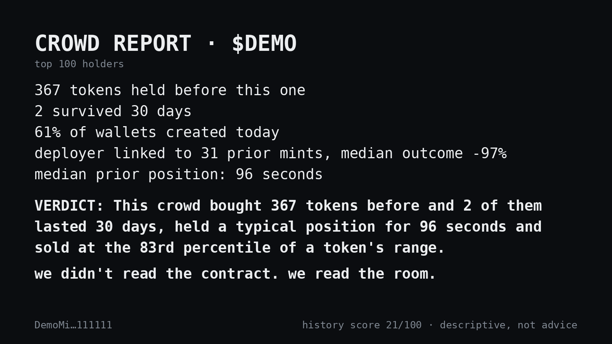

# CROWDCHECK

Paste a Solana token mint. CROWDCHECK does not audit the contract. It audits the
people holding the token right now, and prints one card describing what that crowd
has done before.



*The card above comes from the synthetic fixture in `examples/demo/`. It is invented
data, not a real token.*

## Why

A clean contract costs nothing to produce, so a clean contract proves nothing. A
history is expensive to fake. CROWDCHECK scores history, not code.

**CROWDCHECK never asks for a private key, a signature, a seed phrase or a wallet connection.**

## Install

You need Python 3.11 or newer.

```bash
pipx install git+https://github.com/fxlxsxf/crowdcheck
# or, in a virtualenv:
pip install git+https://github.com/fxlxsxf/crowdcheck
```

From a clone, for development:

```bash
git clone https://github.com/fxlxsxf/crowdcheck && cd crowdcheck
python -m venv .venv && source .venv/bin/activate
pip install -e '.[dev]'
pytest -q
```

## Try it without an API key

The repo ships a synthetic demo crowd, so you can see the whole output for free:

```bash
crowdcheck DemoMint1111111111111111111111111111111111 \
  --provider mock --fixtures examples/demo --as-of 2026-10-01T00:00:00Z
```

## Run it on a real token

1. Get a free Helius key at <https://dashboard.helius.dev>.
2. Export it. Keys are read from environment variables only and are never logged:

   ```bash
   export HELIUS_API_KEY=your_key
   # optional: Birdeye is used as a fallback for mint price history
   export BIRDEYE_API_KEY=your_key
   ```

3. Run:

   ```bash
   crowdcheck <MINT_ADDRESS>
   ```

You get a table in the terminal and a `crowdcheck-<TICKER>.png` card. If a key is
missing, the tool stops and names the variable it needs.

Useful options:

| Option | What it does |
|---|---|
| `--top 50` | analyse the top 50 holders (default 100) |
| `--no-funding-graph` | skip metric 3, the slowest and most fragile one |
| `--max-prior-mints 500` | resolve fewer prior tokens (default 2000) to save API calls |
| `--lookback-days 90` | fetch less wallet history (default 180) |
| `--png out.png` / `--no-png` | choose where the card goes, or skip it |
| `--json report.json` | also write the full report as JSON |
| `--cache path` / `--no-cache` | SQLite cache location (default `~/.cache/crowdcheck/cache.sqlite`) |
| `--provider helius\|birdeye\|mock` | pick the data backend |

**Cost warning.** A full run on a busy token can make thousands of API calls: 100
wallets' histories plus up to 2000 prior tokens. Everything is cached on disk, so a
second run on a similar crowd is much cheaper. Start with `--top 20
--max-prior-mints 200` to see what your plan allows.

## What it measures

| # | Metric | Example line |
|---|---|---|
| 1 | **Crowd track record.** Every token these holders bought on a DEX before. A token *survived* when it traded for at least 30 days and still traded in the last 7. | `412 tokens held by this crowd before, 3 of them survived` |
| 2 | **Wallet age.** Share of holders whose first on-chain activity is under 24 hours old, and under 7 days old. | `61% of these wallets were created today` |
| 3 | **Deployer history.** Creator → the wallet that first funded it → other wallets that funder funded (depth 2, max 50 wallets) → mints they created, and how those mints ended. | `this deployer is linked to 31 prior mints, median outcome -97%` |
| 4 | **Overlap.** The three tokens most shared across these holders (SOL, USDC and USDT ignored). | `47 of 100 of these wallets also hold the same 3 tokens` |
| 5 | **Hold time.** Seconds between first buy and last sell on completed prior positions. | `median prior position lasted 94 seconds` |
| 6 | **Exit percentile.** Where their sell price sat inside each token's observed price range. | `median exit sits at the 81st percentile of a token's range` |

Rules the output follows:

- Every number is computed from fetched data. Anything that can't be resolved prints
  `not visible` with a short reason.
- Each line says how much of the crowd it covers, for example `88 of 100 wallets resolved`.
- The **history score** (0–100) is a weighted sum shown metric by metric, so you can
  check every point. 100 means a long, durable visible history; 0 means fresh and
  short-lived. It is not a safety rating. If three or more metrics are not visible,
  no score is printed.
- **Every threshold and weight is an arbitrary author choice**, not a validated
  finding. They all live in [`src/crowdcheck/config.py`](src/crowdcheck/config.py).
  Change them and the report changes.

## What this is not

- **No price prediction, no entry or exit signals, no alerts.**
- **No "safe" or "risky" label.** Only the track record. There is no buy, sell or
  hold advice anywhere in the output, and a test checks for it.
- **No contract audit.** Tools like Mythril and Slither already exist for that, and
  the whole point here is that the contract is not where the information is.
- **No wallet connection.** CROWDCHECK never asks for a key, a signature or a seed phrase.

This is a descriptive report of public on-chain history. It is not financial advice.

## Known limits

- Prices are reconstructed from swap transactions (SOL or USD leg), so they are
  approximate and include fees.
- Some AMMs don't reference the mint account in their swaps, so Helius alone can
  miss part of a token's history. Setting `BIRDEYE_API_KEY` fills that gap from
  Birdeye's price history.
- Metric 3 links wallets through their *first* funder. If that funder sent SOL to
  more than 50 wallets, it is treated as an exchange or service and not expanded,
  because that link would tie the deployer to strangers.
- Holder ranking only keeps owners that are ordinary System-program wallets, so
  pools, vaults and program accounts drop out.
- The Helius and Birdeye backends are tested against hand-written API responses,
  not live traffic. If an API changes shape, the affected metric shows
  `not visible` instead of crashing. Please open an issue if you see that.

## Project layout

```
src/crowdcheck/
  cli.py          command line (Typer)
  config.py       every threshold and weight
  metrics.py      the six metrics as pure functions
  pipeline.py     fetching, the funding-graph walk, assembling the report
  scoring.py      history score
  verdict.py      the one-sentence verdict
  cache.py        SQLite cache
  http.py         async client: concurrency limit, backoff on 429, no key in errors
  providers/      base interface, helius, birdeye, mock, cache wrapper, fallback
  render/         terminal table and the PNG card
tests/            pytest suite, no network calls (a fixture blocks sockets)
examples/         synthetic demo crowd and its generator
```

## Licence

MIT. The bundled DejaVu Sans Mono font has its own permissive licence in
`src/crowdcheck/render/fonts/LICENSE-DejaVu.txt`.
